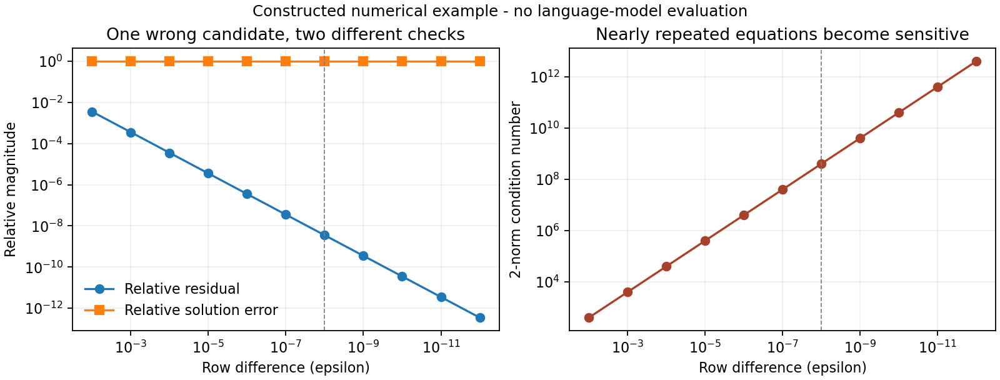

# Multi-Teacher Distillation for Scientific Computing

Project period: October 2026–present.

This reference implementation pairs a synthetic benchmark for checking derivations and scientific Python with a multi-teacher on-policy distillation trainer.

The [task generator](sci_mopd/data.py) pairs derivations and programs by numerical problem and keeps pairs in the same split. The [verifier](sci_mopd/verify.py) checks numerical answers and evaluates a restricted Python AST on the original inputs and two hidden rebindings. Free-text reasoning requires human review.



The [numerical example](numerical_example/numerical_error_values.json) constructs a nearly singular system. The wrong candidate has a relative residual of about 3.54 × 10⁻⁹ and a relative solution error of 1. The plot varies the separation between the two rows while holding the candidate fixed.

## Reference checks

| Check | Reference evidence |
| --- | --- |
| Synthetic task set v2 | 1,984 records, including 256 held-out presentation variants. The ordinary splits have 1,152 train, 288 validation and 288 test records. [Manifest](data/manifest.json) |
| Torch mechanism smoke test | Eight checks cover alignment, output masking, teacher freezing, gradient flow and saving. [Results](verification/torch_smoke.json) |
| Local Hugging Face and PEFT path | A random miniature model exercises two teacher SFT runs, one distillation update, inference and evaluation. [Results](verification/hf_fixture_status.json) |
| Shortcut probes | Fixed keyword and accept-all baselines test whether surface cues reveal the labels. [Results](verification/shortcut_gate.json) |

The [trainer](sci_mopd/train.py) routes sampled outputs to frozen teachers by domain. The [loss](sci_mopd/losses.py) applies a token-level reverse-KL surrogate.

## Run the reference checks

Use Python 3.12 from the repository root.

```bash
python -m venv .venv
source .venv/bin/activate
python -m pip install -r requirements.txt
python -m pytest tests workflow_tools -q
python -m sci_mopd.cli smoke --out runs/torch_smoke.json
python -m sci_mopd.cli data --out data_pilot --groups-per-family 24 --anchor-groups 24 --seed 17
python -m sci_mopd.cli infer --data data_pilot/all.jsonl --out runs/pilot/predictions.jsonl --engine oracle
python -m sci_mopd.cli evaluate --data data_pilot/all.jsonl --predictions runs/pilot/predictions.jsonl --out runs/pilot/evaluation
```

The oracle exercises the target and scoring path with reference answers. The random-model fixture additionally tests the model interfaces without pretrained weights.

```bash
python verification/hf_plumbing_fixture.py
python verification/run_hf_fixture.py
```

The deterministic generator recreates the datasets and writes their manifests. To create the main task set, use `--groups-per-family 384 --anchor-groups 192 --seed 17`. The restricted interpreter is designed for the controlled numerical task grammar.
